<div align="center">


# MIMO Array Visualizer

**60 / 77 / 92 GHz 毫米波 FMCW 雷达的 MIMO 天线阵列性能工作台**

部署在实验室服务器上，局域网内用浏览器打开即可使用。<br>
在同一个界面里完成排阵、DBF 测角评估、频段内性能、规格检查、方案对比、分享和 PDF 报告。

[](LICENSE)


**中文** · [English](#english)

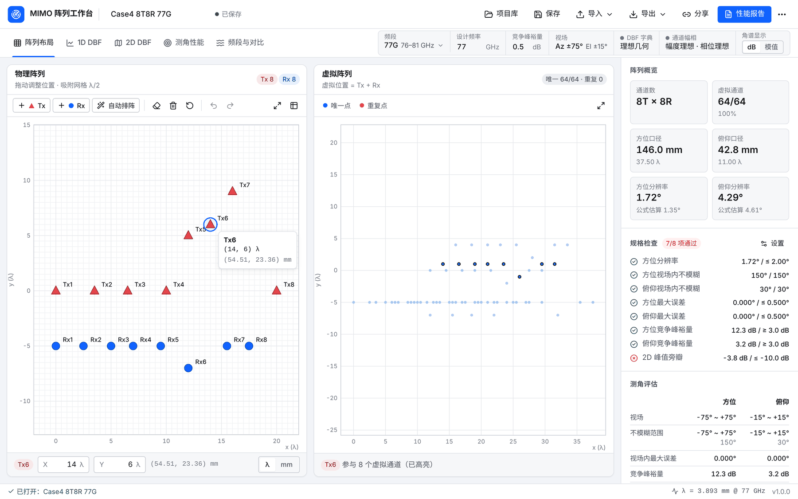

</div>

---

## 它回答哪些问题

设计一套 FMCW 雷达天线阵列时，真正关心的是：这个 Tx/Rx 布局在雷达视场内能否**不模糊地测角**？误差有多大？扫频到频段边缘会不会出现栅瓣？是否满足规格？换一种布局或频段会不会更好？

| 设计问题 | 在哪里看 |
| --- | --- |
| 通道数、虚拟通道利用率、口径、实测 3 dB 分辨率 | 右侧 **阵列概览** |
| 视场内是否会测角模糊、误差多大、竞争峰裕量多少 | **测角性能**、**1D DBF** |
| 方位 × 俯仰二维的模糊与旁瓣 | **2D DBF** |
| 扫频到 76 / 81 GHz 等频段边缘时性能是否变差 | **频段与对比 → 频段内性能** |
| 是否满足分辨率、误差、裕量、PSL 等规格 | 概览 **规格检查**（逐项通过 / 未通过） |
| 60 / 77 / 92 GHz 的几套方案选哪个 | **频段与对比 → 方案对比** |
| 把配置交给同事或客户 | **分享链接**、**性能报告 PDF** |

---

## 界面一览

### 阵列布局

- SVG 编辑器：拖拽 Tx/Rx，松开后吸附到 λ/2 网格（可改为 λ/4、λ/8 或关闭吸附）；支持缩放、平移、方向键微调、删除模式、撤销/重做（50 步）。
- **自动排阵**：输入 T、R 数量，生成标准 MIMO 布局（Rx 间距 λ/2，Tx 间距 N<sub>Rx</sub>·λ/2），即无重复、无栅瓣的 λ/2 虚拟 ULA。
- 坐标表可批量精确编辑，λ / mm 一键切换；选中物理通道时，与它相关的虚拟点会高亮（见顶部大图）。
- 布局检查会提示阵元重合、间距小于 λ/2（可能物理重叠），以及设计频率不在扫频范围内。

### 1D DBF 字典角谱

方位、俯仰各一栏，真实角为视场内 1° 步进的逐帧角度。可以播放、拖动，或点击图上任意位置跳转；底部实时显示真实角、峰值角、误差和竞争峰裕量。

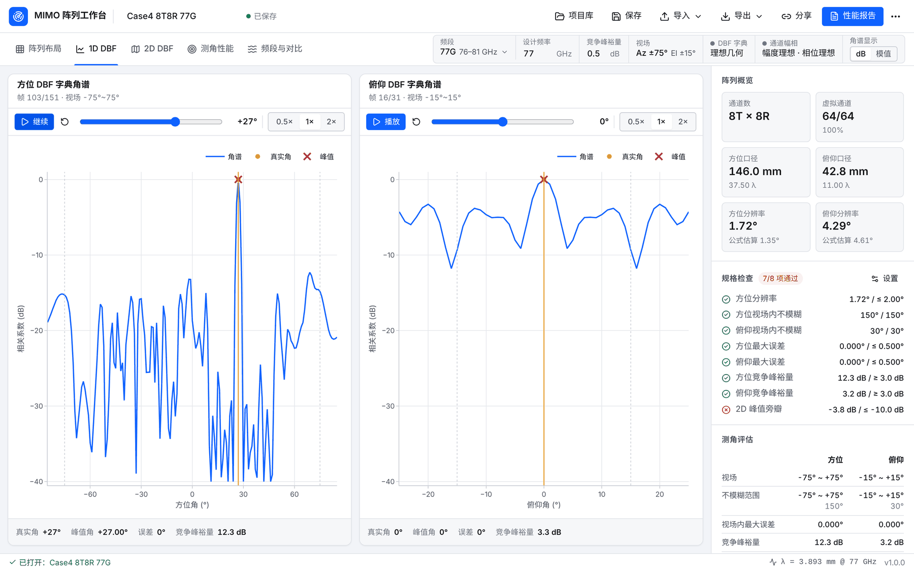

### 2D DBF 相关热图

方位 × 俯仰相关热图，虚线框为雷达视场。点击热图设定真实角；方位、俯仰可分别或同时扫描，服务器端会预取后续帧。

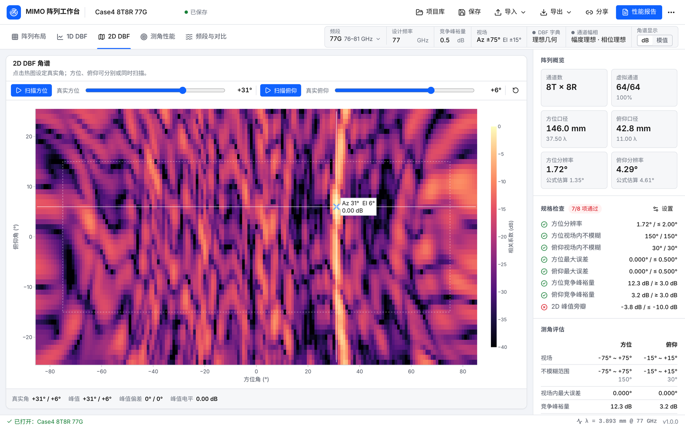

### 测角性能

每个轴上下两张图：逐帧测角误差（峰值细化到 0.002°）和竞争峰裕量，标出不模糊范围和裕量阈值，底部汇总关键指标。

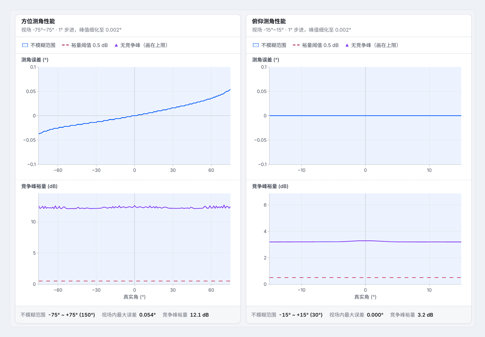

<sub>示例：导入一组模拟的 HFSS 通道相位后，理想字典下方位视场内最大误差为 0.054°。测角误差图 PNG 可通过「导出 → 导出测角误差图 PNG」生成。</sub>

### 频段内性能与方案对比

- **频段内性能**：天线物理位置固定，在扫频起止频率和设计频率处重新评估分辨率、不模糊范围、误差、裕量和 PSL，并逐项做规格判定。下图中，Case4 在 81 GHz 处方位不模糊范围缩到 ±64°、竞争峰裕量降到 0.5 dB：这正是 FMCW 扫频内栅瓣起始角漂移的结果。
- **方案对比**：从项目库勾选最多 7 个方案（例如 60 / 77 / 92 GHz 各自的阵列），与当前项目并排比较。每个方案使用自己的频段、视场和规格。

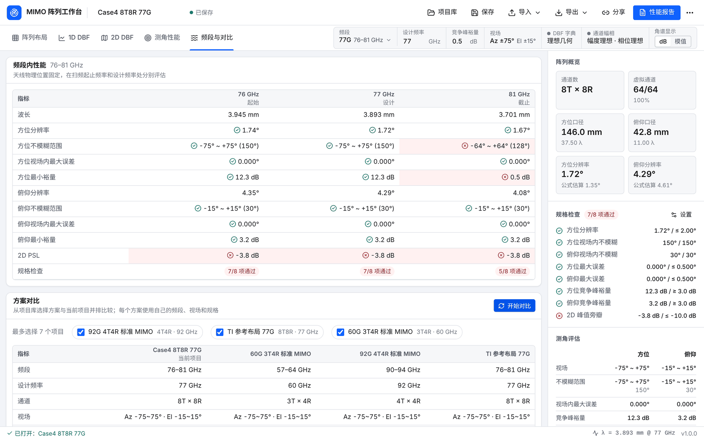

### 评估设置与导入数据

<table>
<tr>
<td width="50%">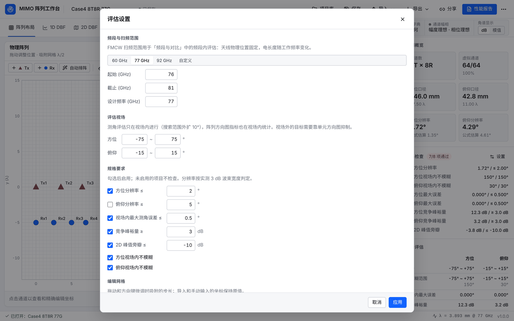</td>
<td width="50%">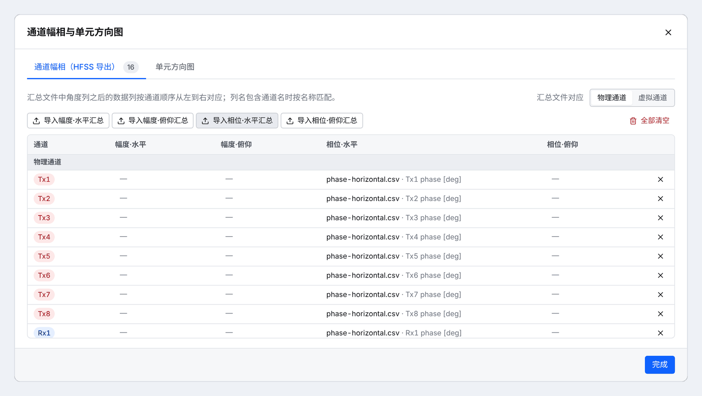</td>
</tr>
<tr>
<td><b>评估设置</b>：频段预设（60G 57–64 / 77G 76–81 / 92G 90–94 GHz）或自定义扫频范围；方位/俯仰视场；规格要求；吸附网格。</td>
<td><b>通道幅相</b>：导入 HFSS 汇总文件（物理或虚拟通道），或为单个通道导入幅度/相位 × 水平/俯仰；支持 dB、度数和复数（<code>1+2j</code>、<code>2∠40</code>）。</td>
</tr>
<tr>
<td>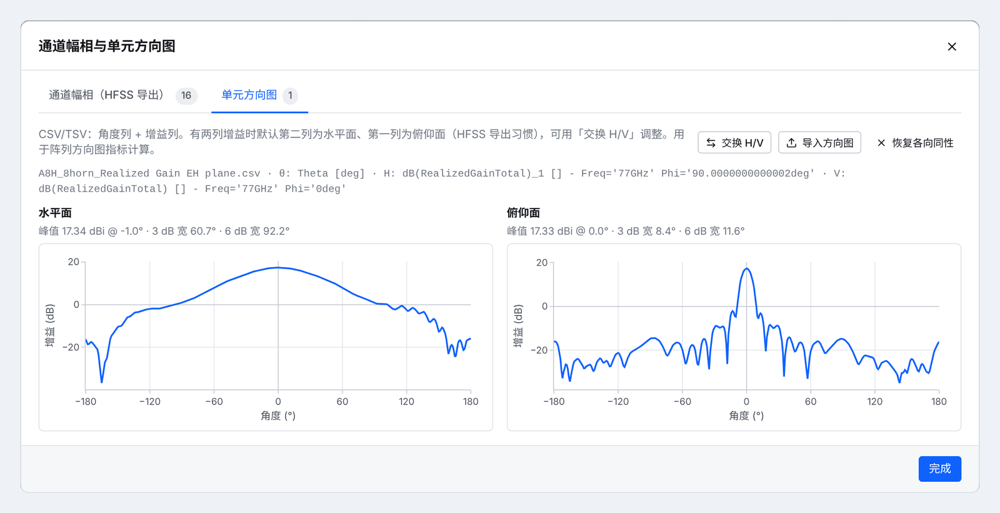</td>
<td>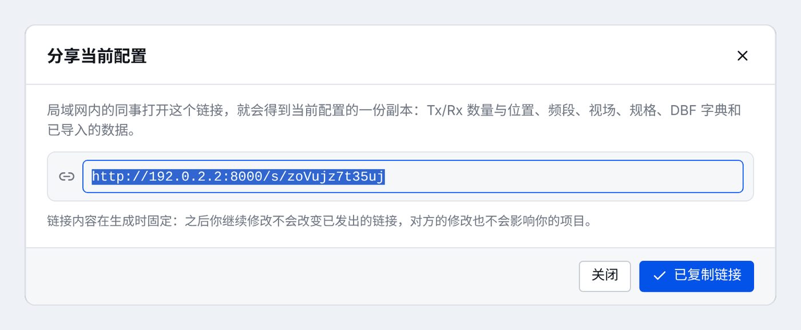</td>
</tr>
<tr>
<td><b>单元方向图</b>：导入 CSV/TSV，预览水平面、俯仰面切面及峰值增益和 3/6 dB 波束宽度，可交换 H/V。</td>
<td><b>分享链接</b>：一键生成 <code>http://服务器:8000/s/xxxxxxxxxxxx</code>，局域网内的同事打开即可得到当前配置的副本。</td>
</tr>
</table>

### 性能报告

服务器在后台生成多页 PDF，内容包括基本指标、阵列与响应、测角误差与裕量、Hold 曲线等。可选附带 CSV/JSON 可复现数据包，生成时显示进度，可以取消，完成后自动下载。

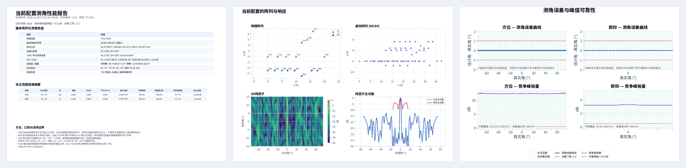

### 深色主题与手机

<table>
<tr>
<td width="53%">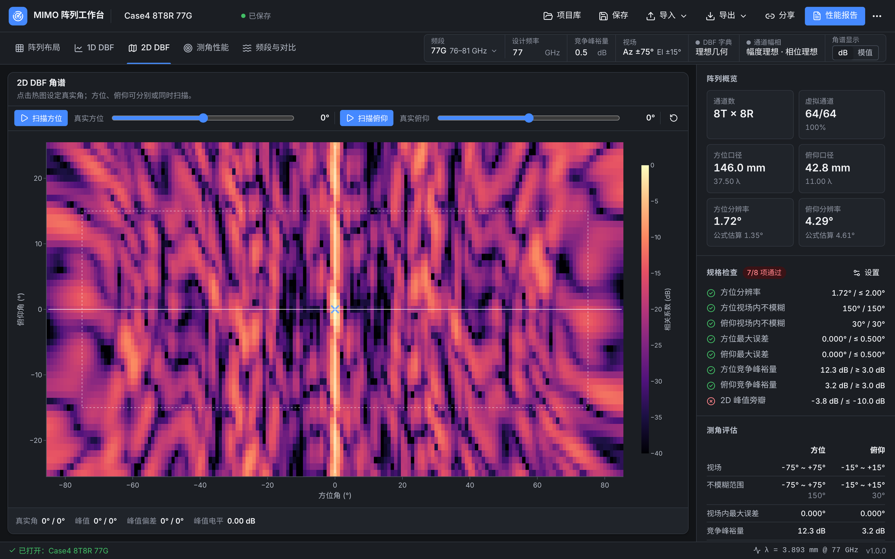</td>
<td width="47%">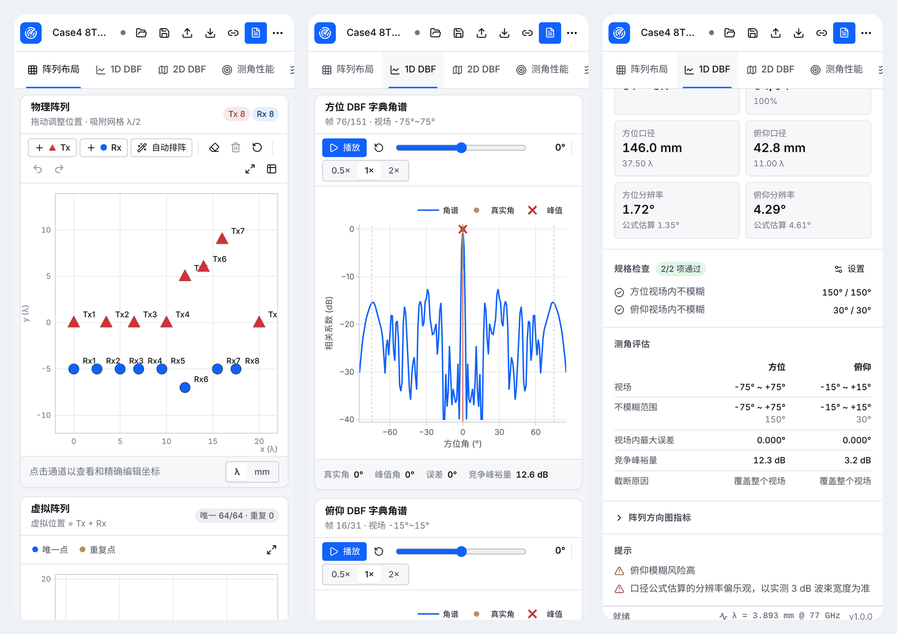</td>
</tr>
<tr>
<td>浅色 / 深色 / 跟随系统主题；中文 / English / 日本語界面。</td>
<td>手机宽度下自动改为单列布局，可在现场用手机查看结果。</td>
</tr>
</table>

---

## 快速开始

```bash
git clone https://github.com/rex991460774/mimo-array-visualizer.git
cd mimo-array-visualizer
docker compose up -d --build
```

浏览器打开 `http://<服务器IP>:8000/`。首次打开时载入参考阵列 Case4 8T8R 77G，可以直接体验所有视图。

---

## 典型使用流程

1. **选频段**：在顶部参数条选择 60G / 77G / 92G，设计频率随之切换（阵列坐标以设计频率下的 λ 保存）。
2. **设视场与规格**：点击「视场」打开评估设置，填写方位/俯仰视场和分辨率、误差、裕量、PSL 等要求。
3. **排阵**：用「自动排阵」生成起点，再拖拽或在坐标表中精确调整；也可以导入桌面版阵面 JSON。
4. **看测角**：在 1D / 2D DBF 和测角性能视图确认视场内不模糊、误差和裕量满足要求。
5. **导入实测数据**（可选）：导入 HFSS 通道幅相、单元方向图或自定义 DBF 字典，评估实际天线。
6. **扫频与对比**：在「频段与对比」检查扫频边缘的性能，并和项目库中的其他方案对比。
7. **交付**：保存到项目库、复制分享链接，或生成 PDF 性能报告。

---

## 分享链接

点击顶部「分享」，会生成形如 `http://192.168.1.10:8000/s/k3J9xQ2mWb7a` 的短链接，复制后发给局域网内的同事即可。

- **包含完整配置**：Tx/Rx 数量与位置、设计频率与扫频范围、视场、规格、DBF 字典设置，以及导入的 HFSS / 方向图数据（数据文件已在同一台服务器上，无需重新上传）。
- **链接内容固定**：链接在生成时保存一份快照。之后你继续修改，已发出的链接不会改变；对方打开后得到的是自己的副本，修改不会影响你的项目，对方也可以把它另存到项目库。
- **相同配置得到相同链接**：链接 ID 由配置内容计算得出，重复分享不会产生重复数据。快照保存在数据目录的 `shares/` 下，随数据卷一起备份。
- **注意访问地址**：链接使用你当前访问的地址。如果在服务器本机用 `localhost` 打开，对话框会提示改用服务器的局域网 IP 后再分享。
- 打开者的浏览器里如果有未保存的修改，会先确认再替换。

---

## 部署

### 方式一：Docker（推荐）

```bash
docker compose up -d --build
```

数据（项目库、导入文件、分享快照、报告任务、日志）保存在 Docker 卷 `mimo-data` 中，升级镜像不会丢失。

- 改端口：编辑 `docker-compose.yml` 中的 `"8000:8000"`，例如改为 `"8080:8000"`。
- 升级：`git pull && docker compose up -d --build`。
- 备份：`docker run --rm -v mimo-array-visualizer_mimo-data:/data -v "$PWD":/backup alpine tar czf /backup/mimo-data.tgz -C /data .`

镜像已内置 Noto CJK 字体，可以直接生成中文/日文 PDF 报告。

### 方式二：Linux 裸机

需要 Python 3.10+ 和 Node.js 20+（仅构建前端时需要）。

```bash
scripts/setup_server.sh                       # 创建 .venv、安装依赖、构建前端
.venv/bin/mimo-array-server --host 0.0.0.0 --port 8000 --data-dir ./data
```

开机自启可参考 `deploy/mimo-array.service`（systemd）。中文报告需要系统安装 CJK 字体（如 `apt install fonts-noto-cjk`）。

升级：

```bash
git pull
scripts/setup_server.sh                       # 每次都按 lock 文件重装前端依赖并重新构建
sudo systemctl restart mimo-array             # 或停止后重新运行上面的启动命令
```

`setup_server.sh` 失败时不要直接重启服务，否则会用旧前端配新后端。

### 方式三：Windows 服务器

```powershell
.\scripts\setup_server.ps1     # 需要 Python 3.10+ 与 Node.js 20+
.\scripts\run_server.ps1       # 默认 0.0.0.0:8000，数据目录 .\data
```

其他电脑访问前，需要在 Windows 防火墙中放行该端口。升级时执行 `git pull`，再运行 `.\scripts\setup_server.ps1`，然后重启 `run_server.ps1`。

### 安全说明

服务没有内置登录鉴权，适合在可信的实验室局域网内使用；能访问服务器的人都能打开项目库和分享链接。命令行方式默认只监听 `127.0.0.1`，需要局域网访问时请显式指定 `--host 0.0.0.0`。如需暴露到更大范围，请在前面加一层带认证的反向代理（如 Nginx Basic Auth）。上传文件仅限 CSV/TSV/TXT/XLSX/XLSM，单个不超过 32 MB。

---

## 功能清单

<details>
<summary><b>雷达评估</b></summary>

- **频段**：60G（57–64 GHz）、77G（76–81 GHz）、92G（默认 90–94 GHz，需按芯片修改）预设，也可自定义扫频范围。
- **评估视场**：测角评估与方向图指标都限定在雷达视场内（DBF 搜索范围外扩 10°），视场外的栅瓣不计为视场内模糊。
- **测角指标**：不模糊范围、视场内最大误差（峰值细化到 0.002°）、竞争峰裕量、截断原因。
- **方向图指标**：实测 3 dB 分辨率、PSL（主瓣取到第一零点）、ISLR、第一旁瓣、栅瓣。
- **频段内性能**：天线物理位置固定，在扫频起止与设计频率处重新评估。
- **规格检查**：分辨率、视场内不模糊、视场内最大误差、竞争峰裕量、2D 峰值旁瓣逐项判定。
- **方案对比**：项目库中的多个方案与当前项目并排比较。

</details>

<details>
<summary><b>数据导入</b></summary>

- **DBF 字典**：理想几何、理想反向相位、通道幅相校准，或导入 CSV/XLSX 字典（方位/俯仰分别导入，支持虚拟或物理通道列，可选相位取反和 0° 校准），附相位矩阵预览和质量提示。
- **通道幅相**：HFSS 汇总文件（物理或虚拟通道），或单个通道的幅度/相位 × 水平/俯仰。
- **单元方向图**：CSV/TSV，可预览 H/V 切面并交换。

</details>

<details>
<summary><b>协作与输出</b></summary>

- **项目库**：项目保存在服务器数据目录，同一服务器的用户共享；浏览器会自动保留当前草稿。每个人的编辑都在自己的浏览器里进行，互不影响；两人同时修改同一个项目时，后保存的人会收到提示，可选择另存为新项目或覆盖对方，不会静默覆盖。
- **分享链接**：`/s/<id>` 短链接，打开即得到配置副本（见上文）。
- **导入导出**：阵面 JSON 与桌面版兼容（version 1，单位 λ，含评估信息）；项目包 `.mimo.zip` 包含配置和全部导入数据，可在服务器之间迁移。
- **性能报告**：多页 PDF，可选 CSV/JSON 可复现数据包；测角误差图 PNG 可单独导出。
- **HTTP API**：所有功能都能通过 REST API 调用，方便脚本批量评估，接口文档见 `/api/docs`。

</details>

---

## 评估方法说明

| 项目 | 做法 | 原因 |
| --- | --- | --- |
| 分辨率 | 阵列响应 0° 切面的实测 3 dB 波束宽度；0.886/D 公式仅作参考 | 公式对稀疏/小阵列不准（case4 公式 1.35°，实测 1.72°） |
| PSL 主瓣区 | 主峰两侧至第一零点（至少下降 3 dB） | 固定 ±2°/±6° 保护区会把小阵列（如 60 GHz 3T4R）的主瓣算成旁瓣 |
| 测角范围 | 真实角在视场内 1° 步进；搜索范围外扩 10° | 实际雷达只在视场内搜索；全 ±90° 搜索会把视场外栅瓣误判为模糊 |
| 测角误差 | 1° 网格取峰后，在峰附近重新计算相关并细化到 0.002° | 只用 1° 网格时误差只能是整数度，无法评估 HFSS 实测数据的亚度级误差 |
| 频段内性能 | 物理坐标固定，电长度按 f/f<sub>设计</sub> 缩放；字典按工作频率匹配 | 反映 FMCW 扫频内栅瓣起始角和分辨率的漂移 |
| 自动排阵 | Rx 间距 λ/2、Tx 间距 N<sub>Rx</sub>·λ/2 | 得到无重复、无栅瓣的 λ/2 虚拟 ULA（标准 MIMO 布局） |

导入的 HFSS 通道相位和自定义字典是单频点数据，频段内评估只缩放几何、不改变这些数据，界面会给出提示。

---

## 开发

```bash
python -m venv .venv && .venv/bin/pip install -e ".[dev]"
.venv/bin/mimo-array-server --port 8000       # 后端

cd web && npm ci && npm run dev               # 前端热更新：http://localhost:5173（/api 代理到 :8000）
```

```bash
.venv/bin/python -m pytest -q                 # 后端测试（计算核心 + API）
.venv/bin/ruff check src tests                # Python lint
cd web && npm run lint && npm test && npx tsc -b   # 前端 ESLint + 单元测试（vitest + Testing Library，jsdom）+ 类型检查
cd web && npm run build                       # 构建到 src/virtual_array/server/static
cd web && npm run e2e                         # 浏览器冒烟测试（Playwright，需先 build；首次运行 npx playwright install chromium）
cd web && E2E_BROWSERS=chromium,firefox,webkit npm run e2e   # 同时跑 Firefox/WebKit（先 npx playwright install firefox webkit）
cd web && npm run coverage                    # 前端单元测试覆盖率（报告在 web/coverage/）
```

参与贡献请先阅读 [CONTRIBUTING.md](CONTRIBUTING.md)。

### 架构

```
浏览器（React 19 + TypeScript + Plotly）
  │  项目文档 JSON（坐标单位：设计频率下的 λ）
  ▼
FastAPI 服务（virtual_array.server）
  ├─ project.py   项目模型（频段 / 视场 / 规格）、v1 阵面 JSON 兼容
  ├─ engine.py    项目 → 计算核心，按依赖字段做 LRU 缓存
  ├─ assets.py    导入文件按 SHA-256 存储
  ├─ store.py     项目库        shares.py  分享快照（/s/<id>）
  └─ jobs.py      报告后台任务
  ▼
计算核心（无 UI 依赖，坐标单位 λ/2）
  geometry · analysis · requirements · dbf_dictionary · element_pattern · performance_report
```

- 1D DBF 一次请求返回视场内全部真实角的角谱（base64 float32），播放全部在浏览器中完成，不需要逐帧请求。
- 2D DBF 使用 `Dbf2dScanner` 复用扫描字典，单帧约 30 ms，前端按批预取。
- 阵列因子改用矩阵乘法计算，约快 2 倍，数值结果与原实现一致（由测试锁定）。

### 项目结构

```
src/virtual_array/
  geometry.py, analysis.py, requirements.py, dbf_dictionary.py,
  element_pattern.py, table_io.py, performance_report.py, phasor.py   计算核心
  project.py, assets.py, engine.py                                    服务层
  server/                       FastAPI 应用、项目库、分享、任务、CLI
  examples/                     参考阵列（case4 8T8R）
web/                            React 前端
docs/images/                    README 截图
tests/                          pytest
deploy/, scripts/, Dockerfile, docker-compose.yml   部署
```

### 从桌面版迁移

桌面版（PySide6）已由 Web 版取代，代码保留在 git 历史中。桌面版导出的阵面 JSON 可以直接通过「导入 → 导入阵面 JSON」打开，频率和裕量设置会一并读取。桌面版中按本地路径引用的字典和方向图文件，需要在 Web 版中重新上传一次；之后它们会保存在服务器上，也可以随项目包一起迁移。

---

## English

MIMO Array Visualizer is a web workbench for designing and evaluating MIMO Tx/Rx antenna arrays for 60 / 77 / 92 GHz FMCW radars. Run it on a lab server and use it from any browser on the LAN.

- **Array editor**: drag-and-snap Tx/Rx with undo/redo, standard MIMO auto layout (filled λ/2 virtual ULA), coordinate table in λ or mm, live virtual-array preview with related-channel highlighting.
- **Angle estimation inside the radar FOV**: 1D DBF spectrum playback, 2D azimuth × elevation heatmap, per-frame angle error refined to 0.002° and competitor-peak margin, no-fold range and cut reasons.
- **Radar-level checks**: band presets with sweep ranges, in-band performance at the sweep edges, measured 3 dB resolution, first-null PSL, requirement pass/fail, side-by-side design comparison, layout overlap checks.
- **Real antenna data**: HFSS channel amplitude/phase, element patterns, and imported or calibrated DBF dictionaries.
- **Collaboration**: shared server-side project library, **share links** (`http://server:8000/s/<id>`) that open a frozen copy of the configuration for anyone on the LAN, desktop-compatible layout JSON, portable `.mimo.zip` bundles, background PDF reports with CSV/JSON data packages, and a REST API at `/api/docs`.
- Chinese / English / Japanese UI, light/dark themes, works at phone width.

**Deploy with Docker**: `docker compose up -d --build`, then open `http://<server>:8000/`.
**Bare metal**: `scripts/setup_server.sh` (or `scripts\setup_server.ps1` on Windows), then `mimo-array-server --host 0.0.0.0 --port 8000 --data-dir ./data`.
The server has no built-in authentication; use it on a trusted network or behind an authenticating reverse proxy.

## License

MIT, see [LICENSE](LICENSE).
